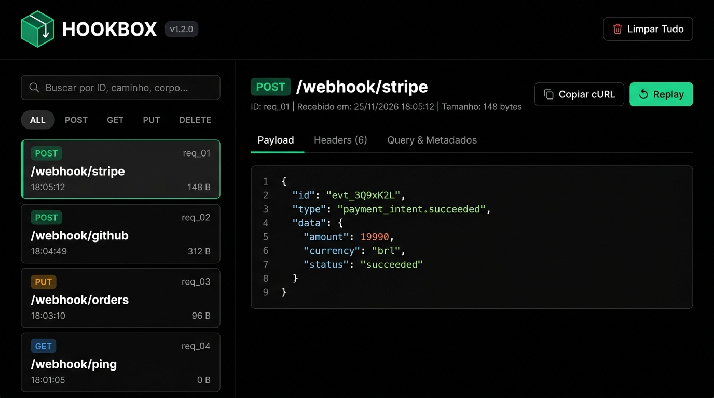

# 📦 Hookbox

> **A local webhook recorder, inspector, and replay tool built in Go** — single binary, embedded SQLite (zero CGO), automatic HMAC re-signing, and a minimalist real-time Web UI.


%20%2F%20JSON-0f172a?style=flat-square)


---

## ⚡ What is Hookbox & How Does It Work?

**Hookbox** is a local black-box recorder and replay proxy for webhooks (Stripe, GitHub, Mercado Pago, Shopify, WhatsApp, etc.).

Instead of repeatedly triggering test checkouts or losing webhook payloads whenever your local backend crashes with a `500` error, Hookbox works in **3 simple steps**:

1. **Capture:** Run `./hookbox listen` to start a local HTTP server (`/webhook/*`) that records every incoming request (HTTP method, path, query params, headers, and raw payload) into a local **SQLite** database or **JSON** file.
2. **Inspect:** Browse captured requests immediately in the built-in solid-black Web UI (`http://localhost:8080`) or directly in your terminal (`./hookbox show req_01`).
3. **Replay:** Re-send any recorded webhook to your local API as many times as you need in milliseconds—including automatic **HMAC re-signing** (so Stripe/GitHub timestamp checks never expire), payload overrides, and real-time forwarding.

---

## 🖥️ Web UI Demo

Hookbox ships with a built-in Web UI embedded directly inside the Go binary (available at `http://localhost:8080`), requiring zero external dependencies or Node.js tooling:



---

## ✨ Key Features

* **Single Zero-Dependency Binary:** Pure Go with static assets embedded via `embed.FS`.
* **SQLite (WAL Mode) + JSON Support:** Powered by pure-Go SQLite (`modernc.org/sqlite`, zero CGO) for fast, multi-process-safe concurrent access, with full backward compatibility for `.json` history files.
* **Real-Time Minimalist Web UI:** Live request stream over Server-Sent Events (SSE), search by ID/path/body, HTTP method filters, formatted JSON viewer, one-click `cURL` copy, and an interactive Replay modal.
* **Automatic HMAC Re-Signing:** Refreshes timestamps and recalculates cryptographic signatures for **Stripe** (`Stripe-Signature`), **GitHub** (`X-Hub-Signature-256`), or any custom HMAC header.
* **Transparent Proxy Mode (`--forward`):** Records incoming webhooks to disk while forwarding them in real time to your target application.
* **Flexible Replay Customization:** Preserve original paths and query strings (`--preserve-path`, `--preserve-query`), inject/override headers (`--header`), or replace payloads (`--data`).
* **OOM Protection:** Configurable request body size limit (`--max-body`, default `10 MB`) via `http.MaxBytesReader`.

---

## 🚀 Installation & Build

### Build from source
```bash
cd hookbox
go build -o hookbox ./cmd/hookbox
```

### Or install into `GOPATH/bin`
```bash
go install ./cmd/hookbox
```

Verify the installation:
```bash
./hookbox --version
# Hookbox v1.2.0
```

---

## 🏁 Quick Start (30 Seconds)

### 1. Start the Hookbox server
```bash
./hookbox listen
```
Output:
```text
==================================================
  📦 Hookbox Recorder & Inspector v1.2.0
  📡 Endpoint Webhooks: http://localhost:8080/webhook/*
  🖥️  Interface Web:     http://localhost:8080/
  💾 Armazenamento:     webhooks.db (SQLite)
  Aguardando webhooks... (Pressione Ctrl+C para parar)
==================================================
```
Open **[http://localhost:8080](http://localhost:8080)** in your browser to view the Web Inspector.

---

### 2. Send webhooks to Hookbox

#### Option A: Locally from your machine (`curl`, Postman, Insomnia)
Send any HTTP request (`POST`, `GET`, `PUT`, `PATCH`, `DELETE`) to `http://localhost:8080/webhook/<anything>`:

```bash
curl -X POST "http://localhost:8080/webhook/stripe?source=checkout" \
  -H "Content-Type: application/json" \
  -H "Stripe-Signature: t=1700000000,v1=original_signature" \
  -d '{"id":"evt_3Q9xK2L","type":"payment_intent.succeeded","data":{"amount":19990,"currency":"brl","status":"succeeded"}}'
```

#### Option B: From external providers on the internet (Stripe, GitHub, etc.)
Since Hookbox runs on `localhost`, expose port `8080` using a tunnel like **ngrok** or **Cloudflare Tunnel**:

```bash
ngrok http 8080
```
Copy the generated HTTPS URL (e.g., `https://abc123.ngrok-free.app`) and paste it into your provider's webhook settings with `/webhook/...` appended:
```text
https://abc123.ngrok-free.app/webhook/stripe
```

---

### 3. Inspect and Replay to your local API

Click **Replay** in the Web UI (`http://localhost:8080`), or run it directly from the terminal:

```bash
# Replay an exact copy to your API running on port 3000
./hookbox replay req_01 --to http://localhost:3000/api/webhooks
```

---

## 📖 CLI Reference

### 1. `listen` — Capture and record webhooks
Starts the webhook receiver on `/webhook/*`, serves the Web UI on `/`, and streams live events on `/api/events`.

```bash
./hookbox listen [options]
```

| Flag | Default | Description |
| :--- | :--- | :--- |
| `--port <port>` | `8080` | Local HTTP port for the receiver and Web UI |
| `--file <path>` | `webhooks.db` | Storage file path (`.db` uses SQLite; `.json` uses JSON) |
| `--forward <url>` | *(empty)* | Enables **Proxy/Tee mode**: records and forwards live requests to your target URL |
| `--max-body <MB>` | `10` | Maximum allowed request body size in Megabytes (OOM protection) |

**Live forwarding example:**
```bash
./hookbox listen --port 8080 --forward http://localhost:3000/api/webhooks
```

---

### 2. `list` — List recorded webhooks
Displays a formatted table of stored webhooks with optional filters.

```bash
./hookbox list [options]
```

| Flag | Default | Description |
| :--- | :--- | :--- |
| `--limit <n>` | `0` *(all)* | Maximum number of records to display |
| `--method <method>` | *(all)* | Filter by HTTP method (`POST`, `GET`, `PUT`, etc.) |
| `--path <substring>` | *(all)* | Filter by path substring (e.g., `/stripe`) |
| `--file <path>` | `webhooks.db` | Path to the SQLite or JSON history file |

**Example:**
```bash
./hookbox list --method POST --path /stripe --limit 10
```

---

### 3. `show` (alias: `inspect`) — Inspect a single webhook
Prints metadata, all captured headers, pretty-printed JSON payload, and a ready-to-run `curl` command.

```bash
./hookbox show req_01
./hookbox inspect req_01 --file webhooks.json
```

---

### 4. `replay` — Re-send a recorded webhook
Dispatches a saved webhook to a local or remote endpoint.

```bash
./hookbox replay <id> --to <target_url> [options]
```

| Flag | Default | Description |
| :--- | :--- | :--- |
| `--to <url>` | *(required)* | Target destination URL (e.g., `http://localhost:3000/api/webhooks`) |
| `--preserve-path` | `false` | Appends the original recorded path (`wh.Path`) to the target URL |
| `--preserve-query` | `false` | Preserves and appends the original query string (`wh.Query`) |
| `--stripe-secret <whsec>` | *(empty)* | Updates timestamp (`t=now`) and recalculates `Stripe-Signature` (HMAC-SHA256) |
| `--github-secret <secret>` | *(empty)* | Recalculates `X-Hub-Signature-256` (HMAC-SHA256) |
| `--hmac-secret <secret>` | *(empty)* | Secret key for generic HMAC-SHA256 signing |
| `--hmac-header <header>` | `X-Signature-256` | Header name used for generic HMAC signing |
| `--data <payload>` | *(empty)* | Overrides the original body payload (alias: `--body`) |
| `--header <key: value>` | *(empty)* | Injects or overrides an HTTP header (e.g., `"Authorization: Bearer token"`) |
| `--file <path>` | `webhooks.db` | Storage file to read from |

> **Note on re-signing:** When combining `--data` with `--stripe-secret`, `--github-secret`, or `--hmac-secret`, Hookbox computes the fresh signature **against the modified payload**.

**Examples:**
```bash
# 1. Replay while preserving original path and query string (/webhook/stripe?source=checkout)
./hookbox replay req_01 --to http://localhost:3000 --preserve-path --preserve-query

# 2. Stripe replay with a fresh signature (avoids >5m timestamp expiration errors)
./hookbox replay req_01 --to http://localhost:3000/api/stripe --stripe-secret whsec_test_123

# 3. GitHub replay recalculating X-Hub-Signature-256
./hookbox replay req_02 --to http://localhost:3000/api/github --github-secret my_secret

# 4. Test failure handling with an overridden body and auth header
./hookbox replay req_01 --to http://localhost:3000/api/webhooks \
  --data '{"status":"failed","reason":"card_declined"}' \
  --header "Authorization: Bearer dev_token_123"
```

---

### 5. `clean` (alias: `clear`) — Clear history
Deletes all recorded webhooks from the storage file.

```bash
# Prompts for confirmation
./hookbox clean

# Skips confirmation prompt
./hookbox clean --force
```

---

### 6. `ui` — Launch Web UI only
Starts the standalone Web Inspector without the webhook capture route emphasis.

```bash
./hookbox ui --port 8080 --file webhooks.db
```

---

## 🏗️ Project Architecture

```text
hookbox/
├── cmd/
│   └── hookbox/
│       └── main.go              # CLI entrypoint (listen, list, show, replay, clean, ui)
├── internal/
│   ├── model/
│   │   └── webhook.go           # Webhook struct and header cloning helpers
│   ├── storage/
│   │   ├── sqlite_store.go      # SQLite persistence (WAL mode) + NewStore factory
│   │   ├── json_store.go        # Atomic JSON file persistence
│   │   └── *_test.go            # Storage unit tests
│   ├── server/
│   │   ├── receiver.go          # HTTP server, MaxBytes guard, Forward mode, REST API & SSE
│   │   └── receiver_test.go     # Server, forward, API, and UI tests
│   ├── replay/
│   │   ├── sender.go            # Replay engine, URL resolution, and tracking headers
│   │   ├── signer.go            # HMAC-SHA256 signing (Stripe / GitHub / Generic)
│   │   └── *_test.go            # Replay and signing unit tests
│   └── ui/
│       ├── ui.go                # Static asset embedding via embed.FS
│       └── assets/
│           └── index.html       # Self-contained solid-black Web UI (HTML/CSS/JS)
├── docs/
│   └── demo.jpg                 # Web UI demonstration screenshot
├── go.mod
└── README.md
```

---

## 🧪 Tests & Quality Checks

Run the full test suite and static analyzer:

```bash
go vet ./...
go test -v ./...
```

---

## ⚠️ Best Practices

* **Do not commit recorded webhook files:** Add `*.db`, `*.db-wal`, `*.db-shm`, and `webhooks.json` to your `.gitignore` so sensitive headers or production payloads are never committed.
* **Replay tracking headers:** Every replayed request automatically includes `X-Hookbox-Replay: true` and `X-Hookbox-Original-ID: <id>` so you can easily distinguish replayed traffic in your application logs.
